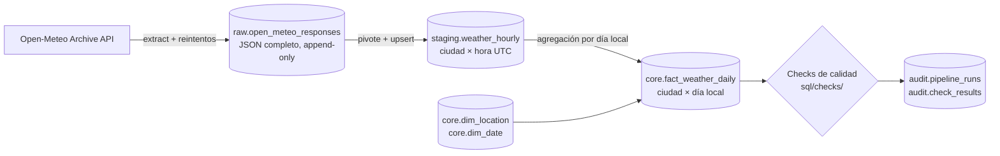

# Weather Pipeline

Pipeline ETL que extrae el clima histórico por hora de la API de
[Open-Meteo](https://open-meteo.com/en/docs/historical-weather-api), lo carga en
un data warehouse PostgreSQL con capas **raw → staging → core** (esquema estrella)
y lo orquesta con **Airflow 3**. Incluye checks de calidad de datos, auditoría de
cada ejecución, alertas de fallo y una suite de tests con CI.



## Requisitos
- Docker y Docker Compose v2.14+ (mínimo 4 GB de RAM asignados a Docker)
- `make` y `python3` (en Windows: WSL2 con la integración de Docker Desktop activada)

## Arranque rápido
```bash
make up      # genera .env, construye la imagen y levanta los servicios
make ps      # espera a que todo esté "healthy"
make ddl     # crea tablas y siembra dim_date y dim_location (idempotente)
```
- UI de Airflow: http://localhost:8080 (credenciales en `.env`)
- Warehouse: `localhost:5433` (o `make psql`)

Despausa el DAG `weather_daily` en la UI y lánzalo con *Trigger*. Para validar solo
el entorno existe `smoke_test`.

## Cómo funciona

El DAG `weather_daily` corre a diario y procesa el día
`data_interval_start − LAG_DAYS` (UTC). El archivo de Open-Meteo reemplaza datos
provisionales (de modelo) por el reanálisis definitivo unos días después; esperar
`LAG_DAYS` (por defecto **5**) evita cargar valores que luego cambian.

```
apply_schema → target_day ─┐
                           └→ start_run → get_locations → extract_city ×ciudad
                                           → load_staging ×ciudad → build_fact
                                           → quality_checks → record_success
```

| Capa | Tabla | Grain (una fila =) |
|---|---|---|
| raw | `raw.open_meteo_responses` | una llamada a la API |
| staging | `staging.weather_hourly` | una ciudad × una hora UTC |
| core | `core.fact_weather_daily` | una ciudad × un día **local** |
| core | `core.dim_location`, `core.dim_date` | ciudad / día calendario |
| audit | `audit.pipeline_runs` | un run del DAG |
| audit | `audit.check_results` | un check en un run |

Detalle de modelo y decisiones en [docs/data_model.md](docs/data_model.md).

### Decisiones de diseño
- **Raw es append-only y guarda el JSON completo**: permite reprocesar sin volver a
  llamar a la API y auditar qué devolvió la fuente.
- **Staging en UTC; el día local se calcula en core.** El día local de Lima va de
  05:00 UTC a 05:00 UTC del día siguiente, por eso cada extracción pide el día UTC
  siguiente también.
- **Todo es idempotente**: DDL con `IF NOT EXISTS`, cargas con `ON CONFLICT`. Repetir
  un run o un backfill no duplica nada. Una respuesta vieja nunca pisa a una nueva.
- **`dim_location` es la fuente de verdad de las ciudades**: agregar una ciudad es un
  `INSERT`, no un cambio de código (el DAG crea una tarea por ciudad en ejecución).
- **`hours_observed` en el hecho** distingue «no llovió» de «faltan datos».
- **La lógica vive en `src/weather/`** sin depender de Airflow; los DAGs solo orquestan.

## Operación

**Cambiar `LAG_DAYS`** sin redeploy (Variable de Airflow):
```bash
docker compose exec airflow-scheduler airflow variables set weather_lag_days 3
```

**Agregar una ciudad:**
```sql
INSERT INTO core.dim_location (location_code, city_name, region, country_code, latitude, longitude, timezone)
VALUES ('PIU', 'Piura', 'Piura', 'PE', -5.19449, -80.63282, 'America/Lima');
```

**Backfill** de un rango de ejecuciones (cada ejecución procesa su día − `LAG_DAYS`):
```bash
docker compose exec airflow-scheduler airflow backfill create \
  --dag-id weather_daily --from-date 2026-10-10 --to-date 2026-10-12 --max-active-runs 1
```
`--max-active-runs` del backfill es independiente del `max_active_runs` del DAG; con
`1` los runs no se solapan. Aun si lo hicieran, las ventanas de días contiguos se
solapan en un día UTC y el guard de `source_response_id` impide que una respuesta vieja
pise a una nueva (por eso `staging_rows` puede ser menor que 48 × ciudades).

**Consultar el resultado:**
```sql
SELECT l.city_name, d.full_date, f.temp_min_c, f.temp_max_c, f.precipitation_total_mm, f.hours_observed
FROM core.fact_weather_daily f
JOIN core.dim_location l USING (location_key)
JOIN core.dim_date d USING (date_key)
ORDER BY d.full_date DESC, l.city_name;
```

### Calidad de datos
Cada archivo de `sql/checks/` es una consulta que devuelve **las filas que violan una
regla** (cero filas = pasa) y declara su severidad en una cabecera
(`-- severity: error|warn`). Un `error` hace fallar el run; un `warn` solo se registra.
Agregar un check es agregar un archivo. Los resultados quedan en `audit.check_results`.

| Check | Severidad | Detecta |
|---|---|---|
| `01_raw_array_lengths` | error | arrays de la respuesta con longitud inesperada |
| `02_staging_null_measures` | warn | horas con alguna medida nula |
| `03_staging_ranges` | error | valores fuera de rangos físicos |
| `04_fact_completeness` | error | ciudad sin fila o con menos de 24 h en el día |
| `05_fact_reconciliation` | error | hecho que no cuadra con lo recalculado desde staging |
| `06_fact_freshness` | warn | pipeline detenido (último día demasiado viejo) |

### Observabilidad
- **Historial de ejecuciones:**
  ```sql
  SELECT run_id, target_day, state, finished_at - started_at AS duration,
         raw_responses, staging_rows, fact_rows, failed_task, error
  FROM audit.pipeline_runs ORDER BY started_at DESC LIMIT 10;
  ```
- **Alertas:** cuando una tarea falla definitivamente (agotados los reintentos) el
  callback la registra en `audit.pipeline_runs`, escribe una línea `PIPELINE_FAILURE`
  en el log y, si defines `ALERT_WEBHOOK_URL` en `.env`, envía un POST JSON
  `{"text": "..."}` (formato compatible con Slack y Discord). Sin URL no se envía nada
  fuera del sistema. Tras cambiarla: `docker compose up -d`.
- **Reintentos en dos niveles:** `tenacity` reintenta la llamada HTTP (429, 5xx,
  timeouts) con backoff exponencial; Airflow reintenta la tarea completa 2 veces.
  Un error 4xx de la API no se reintenta.

## Tests y calidad de código
```bash
python3 -m venv .venv && .venv/bin/pip install -r requirements-dev.txt
make lint        # ruff check + ruff format --check
make test-unit   # unitarios, sin Docker ni red
make test        # + integración (levanta un Postgres efímero con testcontainers)
```
El CI (`.github/workflows/ci.yml`) ejecuta lint y tests en Python 3.12 y 3.13.
Los DAGs no se prueban con pytest (requeriría instalar Airflow); se validan
ejecutándolos en el stack.

## Estructura
| Ruta | Contenido |
|---|---|
| `dags/` | DAGs (solo orquestación) |
| `src/weather/` | Lógica: `extract`, `transform`, `checks`, `audit`, `observability`, `schema` |
| `sql/init/` | Esquemas; se ejecuta al crear el warehouse |
| `sql/ddl/`, `sql/seed/` | Tablas y datos iniciales (idempotentes) |
| `sql/checks/` | Checks de calidad, uno por archivo |
| `tests/unit/`, `tests/integration/` | Tests con pytest |
| `scripts/` | Exploración de la API |
| `docs/data_model.md` | Modelo de datos y decisiones |

## Solución de problemas
- **El puerto 5433 no responde, o los DAGs no aparecen** tras reiniciar WSL/Docker
  Desktop: los contenedores pueden arrancar antes de que los montajes estén listos.
  `docker compose up -d --force-recreate` lo resuelve sin tocar los datos.
- **`make reset` borra los volúmenes** (metadatos de Airflow y warehouse). Es
  destructivo.
- **Cambios en `sql/ddl/`**: `CREATE TABLE IF NOT EXISTS` no altera tablas existentes;
  un cambio de columnas requiere `ALTER TABLE` o recrear la tabla.

## Próximos pasos
Modelar sobre este warehouse con dbt (los checks de `sql/checks/` ya siguen el patrón
de sus tests) y una variante con streaming (Kafka).
