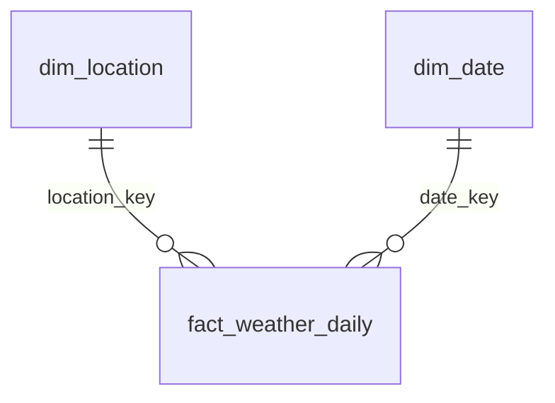

# Modelo de datos

## Fuente

Open-Meteo Historical Weather API (`archive-api.open-meteo.com/v1/archive`).
Datos horarios por coordenada, sin API key. Pedimos los timestamps en UTC
(`timezone=GMT`).

Variables horarias: `temperature_2m`, `relative_humidity_2m`, `precipitation`,
`wind_speed_10m`, `weather_code`.

## Capas y grain

| Capa | Tabla | Grain (qué es una fila) | Llave |
|---|---|---|---|
| raw | `raw.open_meteo_responses` | Una llamada a la API | `response_id` |
| staging | `staging.weather_hourly` | Una ciudad × una hora UTC | `(location_code, observed_at)` |
| core | `core.dim_location` | Una ciudad | `location_key` (natural: `location_code`) |
| core | `core.dim_date` | Un día calendario | `date_key` (YYYYMMDD) |
| core | `core.fact_weather_daily` | Una ciudad × un día local | `(location_key, date_key)` |
| audit | `audit.pipeline_runs` | Un run del DAG | `run_id` |
| audit | `audit.check_results` | Un check en un run | `(run_id, check_name)` |

## Decisiones de diseño

**Raw es append-only y guarda el JSON completo.** Permite reprocesar staging y
core sin volver a llamar a la API, y auditar qué devolvió la fuente en cada
momento.

**Staging en UTC; el día local se calcula en core.** Un día local en Perú
(UTC−5) va de 05:00 UTC del día D a 05:00 UTC del día D+1. Para tener un día
local completo hay que extraer también el día UTC siguiente.

**`dim_location` es la fuente de verdad de las ciudades.** El extractor lee de
ahí las ciudades activas; agregar una ciudad es un `INSERT`, no un cambio de
código. Se mantiene como SCD tipo 1 (se sobrescriben correcciones, sin historial).

**`hours_observed` en el hecho.** Permite distinguir "no llovió" de "faltan
datos" y detectar días incompletos.

## Decisiones tomadas tras la exploración (`make explore`, 2026-10-22)

- **`LAG_DAYS = 5`; el DAG procesa `fecha_lógica − LAG_DAYS`.** La exploración
  mostró que la API *no* devuelve nulos en días recientes (ni siquiera hoy ni
  mañana UTC: 24 h completas), así que los nulos no sirven para medir el
  retraso. Lo que sí cambia es la *calidad*: los días recientes se rellenan con
  datos de modelo/pronóstico y se reemplazan por el reanálisis ERA5 definitivo
  unos 5 días después (dato de la documentación de Open-Meteo, no verificado
  aún por nosotros). Esperar 5 días evita cargar valores provisionales. Como
  raw es append-only, más adelante se puede re-extraer una ventana y comparar
  para validar el valor. Debe ser configurable (variable de entorno / Variable
  de Airflow), no una constante en el código.
- **Se guardan las coordenadas devueltas** en `raw.open_meteo_responses`
  (`api_latitude`, `api_longitude`, `api_elevation_m`). La API ajusta a su
  grilla (Trujillo: pedido −8.1116/−79.0288, devuelto −8.1195/−79.0676, ≈4 km
  y 38 m de elevación). El `payload` ya las contiene, pero en columnas se
  pueden auditar con SQL. `dim_location` conserva las coordenadas *pedidas*
  (las de la ciudad); staging no las necesita (linaje vía `source_response_id`).

## Hechos observados de la API

- Con `timezone=GMT` el offset es 0 y los `time` vienen como `YYYY-MM-DDTHH:MM`
  sin sufijo de zona: hay que interpretarlos como UTC al cargar.
- `hourly` son arrays paralelos de igual longitud (24 × días pedidos); la
  ventana es inclusiva en ambos extremos.
- Unidades por defecto: °C, %, mm, km/h, código WMO (coinciden con los nombres
  de columna de staging).
- Fechas fuera de rango o invertidas → HTTP 400 con cuerpo
  `{"error": true, "reason": "..."}`. Es un error del cliente: no tiene sentido
  reintentarlo (el reintento con backoff es para 429/5xx y timeouts).
- `end_date` máximo permitido = mañana UTC.
